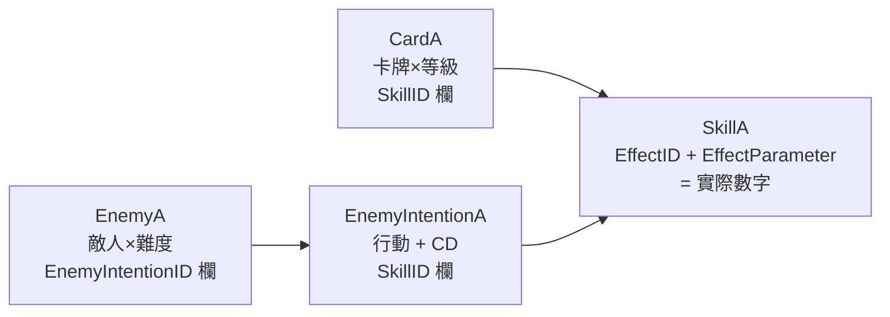

# 數學魔法使 數值平衡交接手冊

2026-10-10 · 線上版：https://claude.ai/code/artifact/0042fd4c-7db7-4368-9e27-f72999902074

## 範圍

新人只負責數值平衡，也就是改 Google Sheet 配置表的數字，**不改 C# 程式**。這份手冊說明每張表在調什麼、改完怎麼讓遊戲吃到新數值、怎麼測試和出 APK。

| 新人可以做 | 新人不需要做 |
| --- | --- |
| 調整敵人血量、傷害、行動模式 | 新增效果類型（EffectName） |
| 調整卡牌費用、傷害、格擋、升級數值 | 新增角色、新增 UI |
| 調整地圖節點、事件、商店與獎勵數量 | 修改存檔格式 |
| 從現有技能組合出新卡牌或新敵人行動 | 改題庫 API |
| 匯出 APK 給測試者 | 上架 Google Play |

程式架構請參考 [Handover.md](Handover.md)，但使用這份手冊不需要讀懂程式。

目前所有卡牌、角色、敵人、地圖的數值整理在 [數值清單](GameData.md)。

## 配置表總覽

遊戲只讀[配置表](https://docs.google.com/spreadsheets/d/1tCaaCrB-9xcP_sgVigBUC5hSNOEx9KzDwsomPIC7asU/edit?usp=sharing)裡的 **4 張工作表**：CardA、SkillA、EnemyA、EnemyIntentionA。工作表名稱以 A 結尾的是「遊戲匯入用」，B 結尾的是「同事備註用」，其餘是設計資料。

| 工作表 | 遊戲會讀嗎 | 用途 |
| --- | --- | --- |
| **SkillA** | 會 | 所有「效果」的數字：傷害、護盾、狀態層數、抽牌數。卡牌和敵人都引用這裡的 SkillID |
| **CardA** | 會 | 每張卡每個等級一列：費用、升級價格、引用的 SkillID、卡牌文字 |
| **EnemyA** | 會 | 每種敵人每個難度一列：血量、是否為 Boss、行動清單 |
| **EnemyIntentionA** | 會 | 敵人的每個行動：引用的 SkillID、冷卻回合（CD）、意圖圖示 |
| CardB、SkillB、EnemyB、EnemyIntentionB、EffectB、BuffB、RelicB | 不會 | 對應 A 表的備註與說明 |
| EffectA、BuffA、RelicA、RelicBuff | 不會 | 效果、狀態、遺物的編號對照表，查詢用。編號寫死在程式裡，改這裡不會生效 |
| 數值框架 | 不會 | 數值設計的依據：1 費 = 7 傷害 = 6 護盾、怪物血量與輸出推算。**新人調數值前必讀** |
| 數學答題、歷程問題一覽、職業敘述、事件發想 | 不會 | 設計討論紀錄 |

四張 A 表用 ID 串起來：卡牌和敵人都不直接寫數字，而是引用 SkillA 的 SkillID。

所以「揮劍傷害從 7 改成 8」是改 SkillA 的一列，而不是改 CardA。要注意：同一個 SkillID 可能被多張卡或多個敵人共用，改之前先搜尋有誰在用。

不在試算表、而是在 Unity 裡調的數值（需要開 Unity 編輯器）：

| 數值 | 位置 | 目前值 |
| --- | --- | --- |
| 每回合抽牌、魔力上限、手牌上限、初始金幣與寶石 | `Assets/Data/GamePlay/遊戲基礎設定.asset` | 抽 5、魔力 3、手牌 8、金幣 100、寶石 10 |
| 金幣掉落、答題寶石、遺物與卡牌掉落率 | `Assets/Data/Containers/物品掉落量.asset` | 小怪 20、精英 50、Boss 100、寶箱與事件 75，浮動 ±20%，層數倍率 1/2/5 |
| 角色血量、初始牌組、初始遺物 | `Assets/Data/Allies/*.asset`、`Assets/Data/Decks/Inital/` | 戰士 75 血 |
| 各職業獎勵卡池 | `Assets/Data/Decks/Reward/` | — |
| 地圖節點配置、每層出哪些敵人組合 | `Assets/Data/Stage/簡單.asset` | 3 層 |
| 敵人組合（一場戰鬥出哪幾隻） | `Assets/Data/Enemy/Enemy Encounter Overview.asset` | — |
| 事件選項與獎勵 | `Assets/Data/Event/事件.asset` | 2 個事件 |
| 營火回血比例 | 營火畫面的 CampFireCanvas 元件 | 30% |

遺物效果的數字（例如雞腿回 7 血）寫在程式裡，調整需要程式人員。

## 各工作表欄位說明

目前的資料量：SkillA 402 列、CardA 166 列（42 組卡）、EnemyA 47 列、EnemyIntentionA 104 列。沒有列在下表的欄位是備註，遊戲不會讀。

### SkillA：效果數字

| 欄位 | 意思 | 注意 |
| --- | --- | --- |
| SkillID | 技能編號，不可重複 | 開頭 1 傷害、2 護盾、3 狀態、4 魔力、5 條件效果、9xx 敵人專用（例如 91 惡魔、95 機器士兵） |
| EffectID | 效果類型 | 只能用程式已有的編號，見下表 |
| EffectParameter | 效果參數，逗號分隔 | 例如 `7, 1` = 7 點傷害打 1 次 |
| Target | 對誰生效 | 0 玩家、1 指定對象、2 全部怪物、3 隨機怪物。敵人技能的 1 是「怪物自己」 |
| ps | 名稱 | 敵人技能的 ps 會顯示在遊戲中 |

常用的 EffectID 與參數（完整清單在 EffectA 工作表）：

| EffectID | 效果 | EffectParameter | 使用次數 |
| --- | --- | --- | --- |
| 20001 | 造成傷害 | 傷害, 次數 | 160 |
| 20003 | 給予狀態 | 狀態編號, 層數 | 130 |
| 20002 | 獲得護盾 | 護盾, 次數 | 59 |
| 20010 | 依數量造成傷害 | 計數來源, 每單位傷害 | 10 |
| 90001 | 符合條件時執行另一個效果 | 條件, EffectID, 該效果的參數 | 10 |
| 20007 | 回復魔力 | 魔力 | 6 |
| 20021 | 抽牌 | 張數 | 6 |
| 30001 | 召喚敵人（敵人專用） | 數量, 敵人 ID… | 4 |

狀態編號（給 20003 用，完整清單在 BuffA）：0 反彈、1 易傷、2 力量、3 無敵、4 狂怒、6 中毒、7 燃燒、12 盔甲、14 蓄力、15 虛弱、21 循環。

### CardA：卡牌×等級

每張卡的每個等級是一列，同一張卡的各等級共用 GroupID，由上往下是 Lv1、Lv2…。

| 欄位 | 意思 | 注意 |
| --- | --- | --- |
| ID | 這個等級的編號，不可重複 | |
| GroupID | 哪一張卡 | 必須對應 Unity 裡的卡牌資料，不要改 |
| SkillID | 這張卡打出時執行的技能，可多個 | 例如 `1000007, 2000001` = 傷害 7 + 護盾 1 |
| ManaCost | 費用 | |
| UpgradeCost | 升到下一級要的金幣 | 基礎卡用金幣，最後一級填 0 |
| UpgradeCostStone | 升到下一級要的寶石 | 獎勵卡用寶石 |
| Class | 職業 | 0 通用、1 戰士、2 獵人、3 法師、4 盜賊 |
| MaxLevel | 是否為最高等級 | 只有最後一列是 TRUE |
| TitleLang / DesLang | 卡名與說明文字 | **改數字時要同步改說明**，說明是手打的 |
| ExhaustAfterPlay | 打出後移除 | |
| TargetChoose | 是否要選擇目標 | 1 要選怪物 |

兩種卡的升級規則不同：

| 類型 | 組數 | 等級 | 升級花費 |
| --- | --- | --- | --- |
| 基礎卡（揮劍、格擋等，每職業 2 組） | 8 | 10 級 | 金幣 50 → 300 → 1200 → … → 50000 |
| 獎勵卡（各職業與通用） | 22 | 3 級 | 寶石 35 → 60（能量卡 50 → 100） |
| 測試卡（GroupID 1001 以上） | 12 | — | 不要動 |

### EnemyA：敵人×難度

| 欄位 | 意思 | 注意 |
| --- | --- | --- |
| ID | 敵人編號 | 末位 1/2/3 = 難度，例如 101、102、103 是低階惡魔的三個難度。不要改 |
| Lang | 名稱 | |
| EnemyIntentionID | 行動清單，依優先順序 | 填 EnemyIntentionA 的 **SkillID 欄**（例如 9101001），不是 ID 欄 |
| StartBattleIntentionID | 開場時執行一次的行動 | 可空白 |
| Prefab | 外觀 | 不要改 |
| IsBoss | 是否為 Boss | |
| MaxHp | 血量 | 主要調整欄位 |

目前血量的基準：小怪 21 / 29 / 50，精英級（機器士兵、蜜蜂） 58 / 81 / 139，Boss 100 / 200 / 300（惡魔王 202 / 222 / 242）。ID 901 以上是測試用敵人。

### EnemyIntentionA：敵人行動

| 欄位 | 意思 | 注意 |
| --- | --- | --- |
| SkillID | 這個行動的名字，也是要執行的 SkillA 技能 | 不可重複 |
| ps | 行動名稱 | |
| CD | 用完後要休息幾回合 | -1 用在開場行動 |
| Intention | 頭上顯示的意圖圖示 | 只能填：攻擊、防禦、強化、上異常、回復、攻擊並上異常、攻擊並防禦、不明 |

敵人每回合的決策：從 EnemyIntentionID 清單的第一個開始，選第一個不在冷卻中的行動；全部在冷卻時用清單最後一個。所以「燃燒 CD 2、護盾 CD 1」的惡魔會先燃燒，再護盾，等燃燒冷卻完再燃燒。

## 改數值的流程

遊戲不會自動讀最新的試算表。數值會存在 Unity 的資料檔裡，打包時用的是這份副本，所以改完表一定要在 Unity 裡「讀取表單」並提交到 git。

1. **改表**：直接在 Google Sheet 上改。不要下載成 Excel 改完再上傳，參數會被轉成日期（見「注意事項」）。改之前在表上記一筆「改了什麼、為什麼」。
2. **讀進 Unity**：開啟 `Assets/Scenes/Main Game/0- Main Menu.unity`，在階層中選「開發者測試器」，按「下載正式資料」。它會讀四張 A 表、更新卡牌資料、存檔，最後自動檢查。
3. **看 Console**：有紅字就回表單修正後重讀。常見訊息：
    - `找不到 SkillInfo: 'xxx'`：卡牌或敵人引用了不存在的 SkillID
    - `重複的 SkillID` / `Duplicate ID`：編號重複
    - `Invalid SkillEffectID`、`Invalid Target`：EffectID 或 Target 填了程式不認得的值
    - `未找到卡片組 xxx 對應的 CardData`：新增了 GroupID，但 Unity 裡沒有對應的卡牌資料
4. **快速測單場戰鬥**：開 `Assets/Scenes/Develop Scene/Test Template 1.unity`，在「開發者測試器」選角色（玩家資料）和敵人組合（產生的敵人們），按 Play 就會直接進戰鬥。按 R 重新開始。
5. **完整跑一輪**：從主選單開新遊戲打完一層，確認金幣、升級節奏合理。作弊面板可以加錢、加寶石、秒殺敵人、清除存檔。
6. **提交**：用 git 提交變更的 `.asset` 檔（`Assets/Data/Cards/`、`Assets/Data/Enemy/` 下），訊息寫改了哪些數值。
7. **出 APK**：`File > Build Settings`，平台選 Android，按 Build。第一次要先安裝 Unity 的 Android Build Support 模組。

想先試數值又不影響正式資料時，改表單的測試分頁（CardTest、SkillTest、EnemyTest、EnemyIntentionTest），在測試場景的開發者測試器按「下載測試資料」，並把「使用數據」切到「測試」。測試資料存在 `Assets/Data/Sheets Test/`，從主選單開始的遊戲不會用到。

手機上也能即時套用新數值：遊戲內作弊面板有「讀取表單」按鈕，會從網路重讀試算表（主選單流程讀正式分頁），但重開遊戲就會還原。適合請測試者幫忙試不同數值，不必每次重新出 APK。

## 常見調整情境

調整前先讀「數值框架」工作表。它定義了換算基準：**1 費 = 7 傷害 = 6 護盾 = 4 回血**，玩家每回合平均造成 15.75 傷害、獲得 9.45 護盾。依此推算，擊倒小怪約 1.3 回合、精英 3.7 回合、Boss 12.8 回合。

| 想做的事 | 改哪裡 | 參考基準 |
| --- | --- | --- |
| 某隻怪太硬或太脆 | EnemyA 的 MaxHp | 小怪 21、精英 58、Boss 202（難度一） |
| 某隻怪打太痛 | 該怪物攻擊技能（SkillA 9 開頭）的傷害；或把 CD 調大 | 每回合輸出：小怪 11.1、精英 13.4、Boss 17.3 |
| 卡牌太強或太弱 | 卡牌引用的 SkillA 數字，或 CardA 的 ManaCost | 0 費卡上限：3 傷害、3 護盾、2 回血 |
| 升級後沒感覺 | 各等級引用的 SkillID | 強度係數 Lv1 100 → Lv4 140 → Lv7 240 → Lv10 420 |
| 升級太貴或太便宜 | CardA 的 UpgradeCost / UpgradeCostStone | 金幣掉落量（在 Unity 的物品掉落量） |
| 金幣太多或太少 | Unity 的「物品掉落量」 | 小怪 20、精英 50、Boss 100，第 2、3 層 ×2、×5 |
| 打完一層血量不夠 | 營火回血比例、怪物攻擊、角色血量 | 營火回 30% 最大血量 |
| 某層太難或太簡單 | Unity 的 `簡單.asset`：每層的敵人組合與權重 | 前幾場小怪從「弱敵人」抽，之後從「強敵人」抽 |

兩個好習慣：

- **一次只改一件事**。同時改血量和傷害，測試後無法判斷是哪個造成的。
- **不要直接改共用的 SkillID**。例如 `1000007`（7 傷害）同時被揮劍、射擊、施法三張卡引用，改了三個職業都會變。只想改一張卡時，引用另一個現有的 SkillID（例如 `1000008` = 8 傷害），或新增一列。改之前在表中搜尋該 SkillID 看有誰在用。

## 注意事項

分析這次下載的配置表時，發現以下幾個要先處理或要告訴新人的問題。

| 問題 | 影響 | 建議 |
| --- | --- | --- |
| SkillA 有 15 格 EffectParameter 被 Google Sheet 識別成日期，例如 9101001 的 `7, 1` 在 Excel 中顯示為 2024-07-01 | 遊戲讀的是表上顯示的文字，目前正常；但一旦格式變動就會讀錯 | 交接前把 EffectParameter 整欄設成「純文字」格式，並告訴新人不要用 Excel 編輯 |
| SkillA 的 5000002、5000003 參數是 `#VALUE!` | 通用卡「機會」Lv2、Lv3 的效果是壞的 | 通用卡（GroupID 21–25）進度標註「待配置表完成」，需先確認是否已上線 |
| CardA 測試卡（GroupID 2001–2004）用了與正式卡重複的 ID（110002、110003） | 可能干擾正式卡的等級資料 | 將測試卡改用不重複的 ID，或刪除 |
| EnemyA 的 503 機器士兵（難度三）行動引用 9502002（難度二的攻擊） | 難度三攻擊力和難度二一樣 | 確認是否應為 9503002 |
| 數值框架的「對應 Boss（難度-層數）」欄被轉成日期 | 只影響閱讀 | 改為純文字 |
| 卡牌說明（DesLang）是手打的 | 改數字但忘記改說明，玩家看到的數字會是錯的 | 每次改 SkillID 或 SkillA 數字時一併檢查 |

其他要記得的事：

- 不要改工作表名稱、欄位名稱和第一列標題，遊戲靠名稱對應。
- 第一欄 ID 空白的列會被忽略，可以用空列分隔。
- 試算表要保持「知道連結的人可以檢視」，遊戲靠公開連結讀表。
- 改之前先建立試算表版本備份（`檔案 > 版本記錄 > 為目前版本命名`），改壞可以還原。

遇到以下情況要找程式人員，改表做不到：

- 需要新的效果類型或新狀態（EffectID、狀態編號不在清單上）
- 調整遺物效果的數字
- 新增卡牌組（GroupID）、新角色、新敵人外觀
- Console 有紅字但表上找不到原因
