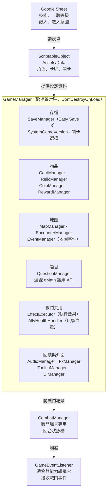

# 數學魔法使 Math Magician — 專案交接文件

最後更新：2026-10-09

## 專案概述

數學魔法使（Math Magician）是一款 Unity 製作的 Roguelite 卡牌遊戲，玩家在戰鬥中解數學題來強化出牌，玩法類似《殺戮尖塔》。

| 項目 | 內容 |
| --- | --- |
| 引擎 | Unity 2021.3.30f1（URP 12.1.12） |
| 語言 | C#，Assets/Scripts 下約 350 支腳本 |
| 可玩角色 | 獵人 Hunter、騎士 Knight、法師 Mage、盜賊 Thief |
| 版本控制 | Git，主分支 main，共約 770 個 commit |
| 開發期間 | 2023-02-09 第一個 commit，最近一次 commit 為 2025-08-14 |
| 宣傳影片 | [YouTube 預告片](https://youtu.be/QCVSIcKTRp8) |

遊戲核心循環：選角色 → 在隨機地圖上選節點 → 戰鬥／答題／事件／營火／商店 → 拿卡牌、金幣、遺物 → 進下一張地圖或關卡。

## 環境建置

一定要用 Unity 2021.3.30f1 開啟，其他版本可能會讓 URP 與第三方套件出錯。

1. 安裝 Unity Hub 與 Unity **2021.3.30f1**。
2. Clone 專案：`git clone https://github.com/Cobra30621/MathQuestionGame.git`（請專案擁有者加你為 collaborator）。
3. 用 Unity Hub「Add project from disk」開啟，第一次匯入會重建 Library，需要一段時間。
4. 開啟 `Assets/Scenes/Main Game/0- Main Menu.unity` 按 Play，從主選單開始測試。
5. IDE 可用 Rider 或 Visual Studio，專案已安裝對應套件。

**建置設定**：Product Name 為 MathMagician，Company Name 為 ZiyouEmathSchool，版本號 1.0.1。Build Settings 內有 5 個場景（見「場景與遊戲流程」）。

**主要第三方套件**

| 套件 | 位置 | 用途 | 注意事項 |
| --- | --- | --- | --- |
| Odin Inspector（Sirenix） | Assets/Plugins/Sirenix | Inspector 擴充、資料編輯介面 | 付費套件，需確認授權 |
| Easy Save 3 | Assets/Plugins/Easy Save 3 | 存讀檔 | 付費套件 |
| Feel（MoreMountains） | Assets/Plugin/Feel | 打擊回饋、動畫效果 | 付費套件 |
| UniRx | Assets/Plugins/UniRx | 事件與 Reactive 處理 | 開源 |
| Zenject | Assets/Plugins/Zenject | 依賴注入 | 開源 |
| Sentry | Assets/Plugins/Sentry、Resources/Sentry | 線上錯誤回報 | 需取得 Sentry 帳號存取權 |
| In-game Debug Console | Assets/Plugins/IngameDebugConsole | 遊戲內 Log 介面 | 開源 |
| Kalkatos DottedArrow | Assets/Plugin/Kalkatos | 出牌時的虛線箭頭（HandController 使用） | — |
| Cartoon FX（JMO Assets） | Assets/JMO Assets | 特效 | 付費套件 |
| Hot Reload | Packages/com.singularitygroup.hotreload | 不重編譯即時更新程式 | 選用，可關閉 |
| AI Toolbox | Assets/AI Toolbox | 編輯器工具 | 遊戲程式沒有參照 |

**外部服務（交接時需取得權限）**

- 題庫 API：`https://api.emath.math.ncu.edu.tw/problem/`（中央大學 eMath 題庫），設定在 `QuestionDownloader.cs`。
- Google Sheet：卡牌等級、技能、敵人、敵人意圖資料透過 opensheet.elk.sh 讀取，都在同一份試算表（ID 開頭 1tCaaCrB…）。
- Sentry 專案與問卷連結（`SurveyButton.cs` 的 Google 表單）。

## 資料夾結構

程式都在 `Assets/Scripts`，資料都在 `Assets/Data`；其餘多半是美術資源與第三方套件，一般維運不太需要動。

**Assets 第一層**

| 資料夾 | 內容 |
| --- | --- |
| Scripts | 遊戲主程式 |
| Data | 所有 ScriptableObject 資料：角色、卡牌、牌組、敵人、事件、關卡、題目、音效、遊戲設定 |
| Map System | 地圖生成系統（MapManager、MapGenerator、MapView 等） |
| Scenes | Main Game（正式場景）、Develop Scene（各成員測試場景）、Test（功能測試） |
| Prefabs | Card、Characters、UI、FX、Core、Background 等預製物 |
| Resources | 題目資源與 Sentry 設定 |
| Sprites、Animation、Audio、Fonts | 美術、動畫、音樂、字型 |
| rStarTools | 從 Google Sheet 讀資料的工具 |
| Editor | 自訂編輯器視窗 |
| Plugins、Plugin、JMO Assets、AI Toolbox | 第三方套件 |

**Assets/Scripts 子資料夾**

| 資料夾 | 支數 | 用途 |
| --- | --- | --- |
| Effect | 38 | 卡牌／技能效果（EffectBase、EffectFactory、各種 Effect） |
| Power | 34 | 狀態效果（Buff／Debuff） |
| Question | 32 | 出題、作答流程、線上題庫下載 |
| Relic | 28 | 遺物與遺物等級 |
| Combat | 25 | 戰鬥流程、Mana、手牌、傷害計算 |
| Characters | 24 | 玩家角色（Ally）與敵人（Enemy） |
| Card | 23 | 卡牌資料、牌組、卡牌等級、顯示 |
| MapEvent | 18 | 地圖事件與選項效果 |
| Economy | 15 | 金幣、商店、升級介面 |
| UI | 13 | 主選單、教學、劇情、通用 UI |
| Tool | 11 | 作弊、測試、開發工具 |
| Encounter | 10 | 敵人遭遇與權重隨機 |
| Reward | 10 | 戰後獎勵 |
| Stage | 10 | 關卡與角色選擇 |
| Utils | 10 | 場景切換、共用工具 |
| Feedback | 9 | 特效與打擊回饋 |
| NueTooltip | 9 | 提示框系統 |
| Save | 7 | 存讀檔（Easy Save 3） |
| VersionControl | 5 | 遊戲版本與存檔版本相容 |
| Managers | 4 | GameManager、Singleton 基底 |
| Aduio | 4 | 音效管理（資料夾名稱拼寫如此） |
| GameListener | 4 | 戰鬥事件監聽 |
| Sheets | 3 | Google Sheet 資料讀取與驗證 |
| CampFire | 2 | 營火 |
| Log | 2 | 事件紀錄與寫檔 |

## 核心架構

所有跨場景的子系統都掛在 `GameManager` 底下，程式一律透過 `GameManager.Instance.XxxManager` 取用；戰鬥場景另有自己的 `CombatManager`。

戰鬥場景由 CombatManager 處理，它以事件通知遺物與能力；數值資料從 Google Sheet 讀進 ScriptableObject，再由各子系統取用。

**兩種 Singleton**（`Assets/Scripts/Managers`）

- `Singleton<T>`：跨場景保留（DontDestroyOnLoad），只有 `GameManager` 使用。各子系統是它上面的欄位，在 Inspector 以 `[Required]` 拖入。
- `SingletonDestroyOnLoad<T>`：離開場景就銷毀，用於 `CombatManager` 與 `CollectionManager`（手牌）。
- 兩者都繼承 Odin 的 `SerializedMonoBehaviour`，所以可以序列化 Dictionary 等型別。

**GameManager 的子系統**

| 分類 | 子系統 |
| --- | --- |
| 存檔 | SaveManager、SystemGameVersion、StageSelectedManager |
| 物品 | RelicManager、CoinManager、CardManager、RewardManager |
| 地圖 | MapManager、EncounterManager、EventManager |
| 回饋 | AudioManager、FxManager、TooltipManager |
| 戰鬥 | EffectExecutor、AllyHealthHandler |
| 其他 | SceneChanger、EventLogger、UIManager、QuestionManager |
| 設定 | GameplayData（「遊戲基礎設定」asset）、AllyDataOverview |

**單局遊戲生命週期**（都在 `GameManager.cs`）

1. `NewGame()`：清除單局存檔 → 依所選角色給初始遺物與牌組 → 初始化地圖與血量 → 存檔 → 開地圖場景。
2. `ContinueGame()`：讀單局存檔 → 開地圖場景。
3. `ExitSingleGame()`：關手牌 → 存檔 → 移除遺物 → 回主選單。
4. `StartDevelopMode()`：開發場景用，不經主選單直接建立單局資料。

**事件系統（GameEventListener）**

戰鬥中的「觸發效果」都靠 `GameEventListener` 實作。遺物、玩家能力（Power）、敵人能力都繼承它，覆寫需要的掛鉤：

- 流程：`OnBattleStart`、`OnRoundStart/End`、`OnTurnStart/End`、`OnBattleWin/Lose`
- 數值修正：`AtDamageGive`、`AtDamageReceive`、`ModifyBlock`、`AtGainTurnStartMana`、`AtGainTurnStartDraw`、`GetCardRawMana`
- 行為：`OnAttack`、`OnBeAttacked`、`OnUseCard`、`OnHealthChanged`、`OnDead`

`CombatManager` 透過靜態類別 `CombatEventTrigger` 觸發，`ListenerGetter` 會收集「所有遺物 + 玩家能力 + 敵人能力」逐一通知。題目流程另外用 `Assets/Data/Channels` 下的 ScriptableObject 事件頻道（OnAnswer、OnEnterQuestionMode、OnQuestionShow）。

**資料與存檔**

- 遊戲資料一律用 ScriptableObject，放在 `Assets/Data`。
- 存檔由 `SaveManager` 統籌，底層用 Easy Save 3（`ES3Handler`）。需要存檔的類別實作 `IDataPersistence`（單局資料 `GameData`）或 `IPermanentDataPersistence`（永久資料 `PermanentGameData`），實作 `LoadData` / `SaveData` 即可。
- 存檔帶有版本號，版本不相容時由 `VersionControl/SaveVersionHandler` 轉換。改動 GameData 結構時要一起處理。

注意：專案雖然引入了 Zenject 與 UniRx，但 `Assets/Scripts` 內目前沒有程式使用。

## 主要系統說明

卡牌與敵人的「效果」都由試算表上的 Skill 資料驅動，再由 `EffectFactory` 轉成程式裡的 Effect 物件；理解這條路徑就能看懂大部分戰鬥邏輯。

### 卡牌（Scripts/Card）

- `CardData`（ScriptableObject）只存「不會變的」設定：卡片 Group Id、圖片、職業、特效。
- 每個等級的數值（費用、升級金幣／寶石、文字、目標、是否消耗、SkillID）來自試算表工作表 `CardA`，以 GroupID 對應。
- `CardManager` 管理玩家牌組（`PlayerDeckHandler`）與卡牌等級（`CardLevelHandler`，永久存檔）。
- 牌組清單為 `DeckData`：正式版卡片（`Assets/Data/Cards/Offical Card`）與開發者卡片（`Develop Tool`）。

### 效果與能力（Scripts/Effect、Scripts/Power）

- `SkillData` 從試算表讀入 `SkillInfo`：SkillID、EffectID（效果種類）、EffectParameter、Target。
- `EffectFactory.BuildEffect` 依 `EffectName` 建立對應 Effect，目前有 20 種（Damage、ApplyBlock、ApplyPower、Heal、DrawCard、GainMana、SpawnEnemy…），未對應的會給 `NullEffect`。
- `EffectExecutor` 依序執行效果，搭配 `Effect/Sequence` 控制特效與延遲。
- Power（能力／Buff）都繼承 `PowerBase`（也是 GameEventListener），分類放在 Buff、Mana、Enemy、Common 等資料夾，共約 25 種。

### 戰鬥（Scripts/Combat）

- `CombatManager` 用 Coroutine 跑狀態機：PrepareCombat → RoundStart → AllyTurn → EnemyTurn → EndRound，循環直到 EndCombat（勝或敗）。
- `ManaManager` 管 Mana，`CardPlayValidator` 判斷能否出牌，`CombatCalculator` 計算傷害，`CollectionManager` 管手牌、抽牌堆、棄牌堆。
- 每個階段開始／結束都會透過 `CombatEventTrigger` 通知遺物與能力。

### 角色與敵人（Scripts/Characters、Scripts/Encounter）

- 玩家角色資料為 `AllyData`（`Assets/Data/Allies`：Hunter、Knight、Mage、Thief），內含血量、初始牌組、初始遺物。
- 敵人數值與敵人意圖（每回合做什麼）來自試算表：`EnemyDataOverview`、`EnemyIntentionData`；外觀對應 `EnemyPrefabData`。
- `EncounterManager` 依關卡與節點類型以權重隨機抽出敵人組合（`Enemy Encounter Overview`）。

### 題目（Scripts/Question）

- 入口有兩個：主選單的「答題」（`NormalQuestionAction`，答題賺寶石）與地圖事件中的答題選項（`EventQuestionAction`，答對給獎勵）。
- 題目依出版社（子由、翰林、康軒、南一）與年級（一上～六下）設定（`QuestionSetting`）。
- `OnlineQuestionDownloader` 從 eMath API 下載題目與題目圖片；網路失敗可改用 `LocalQuestionDownloader`（`Assets/Data/Questions/Local Question Data`）。
- 答題數與寶石掉落的對照表為 `Question stone drop table`。

### 地圖（Assets/Map System）

- `MapManager` 依關卡資料生成地圖，`MapGenerator` 負責隨機佈局，`MapView` 負責顯示。
- 節點類型（`NodeType`）：小怪、精英怪、王、營火、寶箱、商店、事件；各類型外觀設定在 `Assets/Data/Nodes`。
- 關卡設定在 `Assets/Data/Stage`（所有關卡、簡單、角色與難度選擇）。

### 遺物（Scripts/Relic）

- 每個遺物是一個繼承 `RelicBase` 的類別，依職業分資料夾（Hunter、Knight、Mage、Thief、General）。
- 遺物有等級，由 `RelicLevelHandler` 永久存檔；資料表為 `RelicsData`。

### 經濟、獎勵、事件、營火

- 兩種貨幣（`CoinManager`）：Money（金幣）與 Stone（寶石，答題獲得），用於商店與升級卡牌／遺物。
- `RewardManager` 處理戰後獎勵：卡牌、金幣、遺物、回血。
- 地圖事件（`EventManager`）由選項組成，選項效果有：離開、付費換獎勵、得到獎勵、答題、改變血量。資料在 `Assets/Data/Event/事件.asset`。
- 營火（`CampFireCanvas`）可回血或移除卡片。

## 資料維運

數值類資料（技能、卡牌等級、敵人、敵人意圖）的唯一來源是 Google Sheet，改數值要改試算表再「讀取表單」，不要直接改 Unity 裡的 asset。

**試算表與對應 asset**

| 資料 | 工作表 | Unity asset | 程式 |
| --- | --- | --- | --- |
| 技能 | SkillA | Assets/Data/Cards/SkillData.asset | Effect/SkillData.cs |
| 卡牌等級 | CardA | Assets/Data/Cards/CardLevelData.asset | Card/Data/CardLevelData.cs |
| 敵人 | EnemyA | Assets/Data/Enemy/Enemy Data Overview.asset | Characters/Enemy/Data/EnemyDataOverview.cs |
| 敵人意圖 | EnemyIntentionA | Assets/Data/Enemy/Enemy Intention Data.asset | Characters/Enemy/Data/EnemyIntentionData.cs |

四張工作表都在同一份試算表（ID 開頭 1tCaaCrB…）。注意：`SkillData.cs` 與 `CardLevelData.cs` 程式碼裡的預設網址指向另一份舊試算表（17o-e5oC…、`_dev` 工作表），但 asset 上序列化的網址已改成 `SkillA`、`CardA`，實際以 asset 為準。程式透過 opensheet.elk.sh 以 JSON 讀取，所以試算表必須是「知道連結的人都能檢視」。

**更新資料流程**

1. 在 Google Sheet 修改數值（新增卡牌時 GroupID 要與 CardData 的 cardId 一致）。
2. 在 Unity 選取 `Prefabs/Core/開發者測試器.prefab`（或遊戲中的 Cheat Canvas）上的 `SheetDataLoader`（或開發者測試器），按「下載正式資料」；作弊面板則是「讀取表單」。測試分頁（CardTest 等）用「下載測試資料」，存在 `Assets/Data/Sheets Test/`，只在測試場景「使用數據」選測試時才會用到。
3. 它會依序讀技能 → 敵人意圖 → 敵人 → 卡牌等級，再把等級資料寫進正式版與開發者牌組的每張 CardData，並存檔。
4. 最後 `SheetDataValidator` 會檢查 SkillID、意圖等參照是否存在，Console 出現「驗證完成」且沒有錯誤才算成功。
5. 將變動的 `.asset` 一起 commit。這也是為什麼讀一次表單會讓一大批卡片 asset 出現修改。

**新增一張卡牌**

1. 在工作表 CardA 新增各等級的列（同一個 GroupID），需要新效果就先在 SkillA 加技能。
2. 在 `Assets/Data/Cards/Offical Card/<職業>` 建立 CardData（Create → Card），填 cardId、圖片、特效。
3. 把卡片加入 `Assets/Data/Decks/Offical Deck.asset`，並視需要加入初始牌組（Decks/Inital）或獎勵牌組（Decks/Reward）。
4. 讀取表單，確認驗證無誤。

**新增一種效果、能力或遺物（需要寫程式）**

- 效果：在 `EffectName` 加列舉值，繼承 `EffectBase` 寫新類別，再到 `EffectFactory.BuildEffect` 加一行對應。
- 能力：在 `PowerName` 加列舉值，繼承 `PowerBase` 覆寫需要的事件掛鉤，並在 PowersData 加圖示與說明。
- 遺物：在 `RelicName` 加列舉值，繼承 `RelicBase`，並在 RelicsData 加資料。
- 注意：列舉值會被序列化進 asset 與存檔，只能往後加，不要插在中間或刪除。

**其他資料（直接在 Unity 編輯）**

- 角色：`Assets/Data/Allies`
- 關卡與難度：`Assets/Data/Stage`
- 地圖節點：`Assets/Data/Nodes`
- 事件：`Assets/Data/Event/事件.asset`
- 本機題庫與寶石掉落：`Assets/Data/Questions`
- 遊戲基礎設定：`Assets/Data/GamePlay/遊戲基礎設定.asset`

## 場景與遊戲流程

正式遊戲只有 5 個場景，且 `GameManager` prefab 只放在主選單，所以測試正式流程要從 `0- Main Menu` 開始按 Play。

| Build 序號 | 場景（Assets/Scenes/Main Game） | 用途 |
| --- | --- | --- |
| 0 | 0- Main Menu | 主選單：新遊戲／繼續、選角色與難度、答題、升級商店 |
| 1 | 1- Map | 地圖；事件、營火、商店、寶箱都在此場景以 UI 開啟 |
| 2 | 2- Combat Scene | 戰鬥（CombatManager、手牌） |
| 3 | 3-CompleteMap | 完成一張地圖 |
| 4 | 4-Win | 通關 |

場景切換一律經過 `Utils/SceneChanger`（對應 `SceneType` 列舉），新增場景時要同步改 Build Settings 與 SceneType。

**測試場景**

- `Scenes/Develop Scene`：各成員的個人測試場景（Cobra、Ling、Nelson、Reno、Toby 等），另有 `Test Template 1` 範本；新人用選單 Tools → 開發者工具 → 建立我的測試場景，一鍵建立自己的場景、測試角色與牌組（見[新人入門指南](Onboarding.md)）。
- `Scenes/Test`：題目 UI、題目下載、Feel、Odin 等單一功能測試。

**測試工具**

| 工具 | 位置 | 功能 |
| --- | --- | --- |
| 開發者測試器（DevelopTool） | Prefabs/Core/開發者測試器.prefab | 放進戰鬥測試場景即可直接開打：指定角色、敵人組合、題目設定、初始能力；按 R 重載場景 |
| TestTool | GameManager prefab 上（Inspector 按鈕） | 更新事件、更新地圖、加金幣／寶石、擊敗敵人、清除存檔 |
| CheatTool（Cheat Canvas） | Prefabs/UI/Cheat Canvas，包在 UIManager prefab 內 | 遊戲中作弊面板：加錢、加寶石、秒殺、清存檔、讀表單、匯出 Log、測試 Sentry |
| LevelSetterTool | Scripts/Tool | 一次設定卡片／遺物等級 |
| SaveManager 按鈕 | GameManager prefab → SaveManager | 讀檔、清除所有資料 |

**Log 與錯誤追蹤**

- `EventLogger` 紀錄遊戲事件，可從作弊面板匯出到 `Application.persistentDataPath` 下的 `user_logs.txt` 與 `user_detail_logs.txt`。
- 正式版錯誤會回報到 Sentry。

## 常見維運任務與已知問題

日常維運多半是「調數值 → 讀表單 → 測試 → 建置」；下面的問題是從程式碼盤點出來的，接手後建議優先處理前三項。

**常見任務**

| 任務 | 做法 |
| --- | --- |
| 調整卡牌／敵人數值 | 改 Google Sheet → 讀取表單 → 確認驗證無誤 → commit asset（見「資料維運」） |
| 新增卡牌 | 見「資料維運 → 新增一張卡牌」 |
| 新增事件 | 編輯 `Assets/Data/Event/事件.asset`，用 TestTool「更新事件」測試 |
| 調整關卡、敵人出現機率 | 編輯 `Assets/Data/Stage` 與 `Enemy Encounter Overview` |
| 測試單場戰鬥 | Tools → 開發者工具 → 建立我的測試場景（`Assets/Editor/DevSceneCreator.cs`），設定開發者測試器的敵人後按 Play |
| 玩家回報問題 | 請玩家用作弊面板匯出 Log，或到 Sentry 查錯誤 |
| 存檔結構改變 | 更新 GameData 後，在 VersionControl 加版本轉換，避免舊存檔壞掉 |
| 發布新版 | 更新 Player Settings 的 bundleVersion 與 SystemGameVersion，從 Build Settings 建置 |

**已知問題與建議**

- [ ] 題庫 API 的授權 Token 直接寫在 `Question/QuestionLoader/QuestionDownloader.cs`，而且已進入 Git 歷史。建議與題庫端確認是否需要換新 Token，並改由設定檔讀取。
- [ ] 作弊面板（Cheat Canvas）包在 UIManager prefab 內，正式版也會帶入。建議確認是否需要在正式建置中關閉。
- [ ] `SkillData.cs`、`CardLevelData.cs` 的程式預設網址仍指向舊試算表（17o-e5oC…）。asset 上的設定才是實際使用的，建議把程式預設值也改成 SkillA、CardA，避免重建 asset 時讀到舊表。
- [ ] Standalone 的 Application Identifier 仍是預設值 `com.DefaultCompany.2DProject`。
- [ ] 專案根目錄有被 commit 的暫存檔：`mono_crash.*`、`api_results.csv`，可移除並加入 .gitignore。
- [ ] Zenject、UniRx、AI Toolbox 已匯入但遊戲程式沒有使用，可評估移除以減少編譯時間。
- [ ] 資料夾名稱有拼寫錯誤（`Scripts/Aduio`、`Offical Card`、`Decks/Inital`）。移動資料夾要在 Unity 內做，否則會壞掉參照，若不影響就先不動。
- [ ] `Encounter/Data/EncounterData.cs` 第 28 行有一個「TODO 刪除」尚未處理。
- [ ] 沒有自動化測試（未使用 Unity Test Framework），修改戰鬥邏輯後要手動測試。

## 參考資料與聯絡窗口

既有的設計文件在 HackMD，程式內註解也有指向對應文章。

- [數值平衡交接手冊](BalanceHandover.md)：只負責調數值的新人從這份開始
- [GitHub Repo](https://github.com/Cobra30621/MathQuestionGame)
- [專案文件（HackMD）](https://hackmd.io/@Cobra3279/HJK2qpy9h/%2F7ZU6DAlyRvS1JLM7dXL0dA)
- [題目資料設定說明（HackMD）](https://hackmd.io/@Cobra3279/B1NeCrmh3)
- [角色系統文件（HackMD）](https://hackmd.io/@Cobra3279/HJK2qpy9h/%2FNLPqD8z3QaO6heSAZ-rBXA)
- [宣傳影片](https://youtu.be/QCVSIcKTRp8)
- [玩家問卷（Google 表單）](https://forms.gle/XnkTpZjWz4SmEvAV7)

**交接時需要轉移的權限**

| 項目 | 目前窗口 | 新人需要的權限 |
| --- | --- | --- |
| GitHub Repo | Cobra | Collaborator（可 push） |
| Google Sheet（兩份） | Cobra | 編輯權 |
| eMath 題庫 API | 待確認 | API Token 與對口窗口 |
| Sentry | Cobra | 專案成員 |
| 付費套件授權（Odin、Easy Save 3、Feel、Cartoon FX） | 待確認 | 確認授權是否允許新人使用 |

過去的主要貢獻者（依 Git 紀錄）：Cobra、nelsonkct、linglinghsieh00、郭建廷、RenoArsl。
