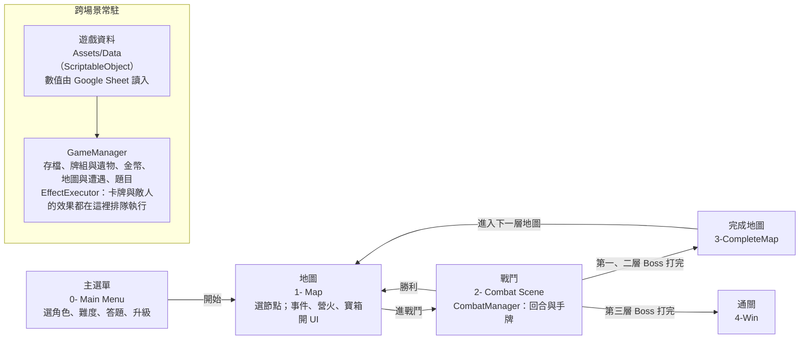

# 數學魔法使 新人入門指南

2026-10-15 · 線上版：https://claude.ai/code/artifact/52792cc8-7b7b-4ccf-9f5f-11f977c46784

在第一次交接之前，請先自行完成下面 6 件事，並帶著 3 個看不懂的問題來。之後的工作是用 AI 工具修正遊戲的當機與操作 bug，這份指南只教「能指揮 AI、看得懂 AI 回覆」需要的知識。

## 你的任務

完成一項就勾一項。全部勾完，就可以開始第一次交接。

- [ ] 完成 Unity 入門課程的前幾個單元，會操作編輯器即可（見「Unity 必學概念」）
- [ ] 安裝 Unity 2021.3.30f1，**包含 Android Build Support 模組**（見「安裝環境」）
- [ ] Clone 專案，能正常開啟並從主選單按 Play
- [ ] 準備好自己的 AI 開發工具（Claude、OpenCode、Kilo 等），並能讓它讀到專案資料夾
- [ ] 至少玩過並通關一次遊戲（見「玩一輪遊戲」）
- [ ] 讀過程式交接文件，並用 AI 工具認識專案，寫下 3 個看不懂的地方（見「用 AI 認識專案」）

**過關條件**：以上全部完成，帶著 3 個問題進入第一次交接。問題可以直接留言在線上版文件上。

卡住超過 30 分鐘，先把錯誤訊息貼給 AI 問；還是解不了，就在線上版文件留言，寫下你做了什麼、看到什麼。

## 安裝環境

一定要用 **Unity 2021.3.30f1**，其他版本可能讓專案或第三方套件出錯。

1. 安裝 Unity Hub（從 [Unity 官網](https://unity.com/download) 下載，需要註冊 Unity 帳號）。
2. 開啟 [Unity 2021.3.30f1 的發布頁](https://unity.com/releases/editor/whats-new/2021.3.30)，按 Install 用 Unity Hub 安裝。
3. 安裝時勾選三個模組：**Android Build Support**、**Android SDK & NDK Tools**、**OpenJDK**。已經裝好但漏勾的話，在 Unity Hub 的「Installs」對該版本選「Add modules」補裝（[官方說明](https://docs.unity3d.com/2021.3/Documentation/Manual/android-install-dependencies.html)）。沒有這些就無法輸出 APK。
4. 請專案擁有者把你的 GitHub 帳號加為 collaborator，再 Clone：`git clone https://github.com/Cobra30621/MathQuestionGame.git`。Git 歷史約 720 MB，請用穩定的網路。
5. 在 Unity Hub 選「Add project from disk」開啟專案。第一次開啟會重建 Library 資料夾，需要一段時間。
6. 開啟 `Assets/Scenes/Main Game/0- Main Menu.unity`，按 Play。看到主選單且 Console 沒有紅字，就完成了。

**一定要從主選單場景開始按 Play**：GameManager 只放在主選單場景裡，直接從地圖或戰鬥場景按 Play 會報錯。

## Unity 必學概念

先從官方的 [Unity Essentials 入門課程](https://learn.unity.com/pathway/unity-essentials) 開始，做到「Unity Editor Essentials」與「GameObjects」的部分，會操作編輯器就夠了。剩下的不用全學，只要懂下表這些概念；它們都是之後判斷 AI 回覆時會用到的。

| 概念 | 一句話說明 | 在這個專案哪裡 | 去哪裡學 |
| --- | --- | --- | --- |
| GameObject 與 Component | 場景裡的每個物件都是 GameObject，它的功能來自掛在上面的 Component（包括我們寫的 C# 腳本） | 戰鬥中的角色、敵人、手牌 | [GameObjects](https://docs.unity3d.com/2021.3/Documentation/Manual/GameObjects.html) |
| Inspector 與拖曳的參照 | 在 Inspector 設定的欄位存在場景或 Prefab 裡，**AI 讀程式碼看不到**，很多 bug 出在這裡 | GameManager 的各子系統都是在 Inspector 拖入的 | [The Inspector window](https://docs.unity3d.com/2021.3/Documentation/Manual/UsingTheInspector.html) |
| Prefab | 設定好、可重複使用的物件範本，改 Prefab 會影響所有用到它的地方 | GameManager、卡牌、角色、開發者測試器 | [Prefabs](https://docs.unity3d.com/2021.3/Documentation/Manual/Prefabs.html) |
| 場景與 DontDestroyOnLoad | 換場景時一般物件會被銷毀，標記 DontDestroyOnLoad 的會留下來 | GameManager 從頭到尾都在；CombatManager 離開戰鬥就消失 | [DontDestroyOnLoad](https://docs.unity3d.com/2021.3/Documentation/ScriptReference/Object.DontDestroyOnLoad.html) |
| 生命週期 | Awake、OnEnable、Start、OnDestroy 等函式由 Unity 依固定順序呼叫 | 事件在 OnEnable 訂閱、OnDestroy 解除；忘了解除就會對已銷毀的物件呼叫 | [Order of execution](https://docs.unity3d.com/2021.3/Documentation/Manual/ExecutionOrder.html) |
| Coroutine | 可以「等一下再繼續」的流程，跨多個畫面更新執行 | 戰鬥的回合流程（CombatManager）、題目下載 | [Coroutines](https://docs.unity3d.com/2021.3/Documentation/Manual/Coroutines.html) |
| ScriptableObject | 存成檔案的資料，不掛在場景裡 | `Assets/Data` 下的角色、卡牌、敵人、關卡 | [ScriptableObject](https://docs.unity3d.com/2021.3/Documentation/Manual/class-ScriptableObject.html) |
| Console 與 stack trace | 顯示錯誤訊息；點一下可以看到是哪個檔案哪一行出錯 | 修任何 bug 的第一步 | [Console Window](https://docs.unity3d.com/2021.3/Documentation/Manual/Console.html) |
| Git 分支與 PR | 在自己的分支改完，開 Pull Request 請人審查後再合併 | 之後每個修正都要開 PR | [About pull requests](https://docs.github.com/en/pull-requests/collaborating-with-pull-requests/proposing-changes-to-your-work-with-pull-requests/about-pull-requests)（英文） |

看不懂官方文件時，可以請 AI 用這個專案的程式當例子解釋，例如「用 CombatManager.cs 的內容解釋 Coroutine 是什麼」。

## 專案怎麼運作

一局遊戲走過 5 個場景，GameManager 從頭到尾都在。



場景換了，場景裡的物件就會被銷毀；GameManager 上的子系統則一直存在，程式裡用 `GameManager.Instance.XxxManager` 取用。這裡的狀態換場景不會重置，是卡死 bug 的常見來源。了解「哪些東西會留下來、哪些會消失」，是看懂大部分卡死 bug 的關鍵。

## 用 AI 認識專案

先讀[程式交接文件](Handover.md)，再讓 AI 工具開啟專案資料夾，照順序問下面的問題。**這個階段只問不改**，先不要讓 AI 修改任何檔案。

1. 「請先讀 Docs/Handover.md，再用 5 句話介紹這個專案在做什麼、有哪些主要系統。」
2. 「從主選單按下新遊戲，到進入第一場戰鬥，會經過哪些腳本與函式？請列出檔案路徑。」
3. 「CombatManager 的回合流程是怎麼運作的？玩家按下『結束回合』之後發生了什麼事？」
4. 「一張卡打出去之後，效果是怎麼被執行的？請說明 BattleCard、EffectFactory、EffectExecutor 的關係。」
5. 「哪些物件會跨場景一直存在？哪些換場景就會消失？」
6. 「Google Sheet 上的數值是怎麼進到遊戲裡的？」

三個好習慣：

- **要求 AI 列出檔案路徑與函式名稱**，再自己打開檔案核對。AI 有時會說錯，檢查過才算懂。
- 看不懂就追問：「這句話是什麼意思？用更簡單的方式說」。
- 把你問過、但還是不確定的地方記下來，從中挑 3 個當作交接時的問題。

## 玩一輪遊戲

在 Unity 編輯器裡從主選單按 Play，選一個角色開新遊戲，打完整個關卡。目前只有一個關卡，共 3 層地圖，每層最後是 Boss。

- **可以用作弊面板加速**：遊戲畫面上有開啟作弊面板的按鈕，可以加金幣、加寶石、秒殺所有敵人。重點是走完整個流程，不是靠實力通關。
- **每種節點都要走過至少一次**：戰鬥、精英、Boss、營火、寶箱、事件。也試一次主選單的「答題」與升級商店。
- **開著 Console 玩**：出現紅字或遊戲卡住時，截圖並記下你剛剛做了什麼。這些就是之後要修的 bug，可以對照 [Bug 清單](BugList.md) 看看是不是已經列過。
- **邊玩邊想「這個畫面是哪個系統在處理」**，對照上方「專案怎麼運作」的圖。

## 建立自己的測試場景

修 bug 時，不必每次都從主選單一路玩到出問題的戰鬥。`Assets/Scenes/Develop Scene/` 裡的開發場景放了「開發者測試器」，按 Play 就直接進入指定的戰鬥。它自帶 GameManager，所以是「一定要從主選單按 Play」的例外。每個人用下面的按鈕建立一份自己的。

### 1. 一鍵建立

1. 在 Unity 選單選 **Tools → 開發者工具 → 建立我的測試場景**。
2. 輸入你的名字（建議用英文，例如 `Amy`），按 **建立**。
3. 跳出「建立完成」就好了，場景會自動開啟。

這個按鈕會一次做完下面的事：

| 建立或修改的檔案 | 內容 |
| --- | --- |
| `Assets/Scenes/Develop Scene/<名字> Test.unity` | 從 `Test Template 1` 複製的場景，開發者測試器已設成你的角色 |
| `Assets/Data/Allies/Test/<名字> Test.asset` | 你的測試角色，從 `Test Ally` 複製，下拉選單顯示「<名字>測試」 |
| `Assets/Data/Decks/Develop/<名字> Deck.asset` | 你的個人牌組，作為角色的初始卡牌 |
| `Assets/Data/Allies/ally data overview.asset` | 把你的角色加進總覽，下拉選單才找得到 |

已經有同名角色或牌組時會直接沿用，不會覆蓋；同名場景已存在時則不會建立。

**不要用 Ctrl/Cmd + D 手動複製角色。** 複製出來的角色會和原本的角色共用同一個 `dataId`，下拉選單選到的其實是原本那一個。按鈕會自動換一個新的 `dataId`。另外，**不要改 `Test Template 1` 本身**，它是大家共用的範本。

### 2. 設定要測的內容

- **牌組與遺物**：選取你的角色（`<名字> Test.asset`），改「玩家初始遺物」；打開你的牌組（`<名字> Deck.asset`）增減卡片。改的都是自己的檔案，不會影響別人。
- **敵人與其他設定**：在 Hierarchy 展開 `開發者測試器`，選取同名的子物件，在 `DevelopTool` 設定：

| 欄位 | 設什麼 |
| --- | --- |
| 玩家資料 | 已設成你的角色；也可以換成正式角色（Knight、Hunter、Mage、Thief） |
| 產生的敵人們 | 要對戰的遭遇，例如「樹精群(1)-難度1」；「史、惡、樹、機」是四種敵人各一隻 |
| 玩家初始獲得的能力 | 選填，開場給的 Power。可能因執行時機而無效，使用前先確認 |
| 遊戲開始時，執行事件 | 選填，開場要呼叫的方法 |

改完場景按 **Ctrl/Cmd + S** 存檔。

### 3. 按 Play 驗證

應該會直接進入戰鬥，Console 依序出現「開發者模式」、「創建 - 新的單局遊戲」、「---------- 戰鬥開始 ----------」。

| 症狀 | 處理 |
| --- | --- |
| 選單沒有「開發者工具」 | 先看 Console 有沒有編譯錯誤（紅字），修好後 Unity 才會載入選單 |
| `The GameObject of type ... is not present in the scene` | 場景少了 Manager，刪掉場景重新用按鈕建立 |
| 想重開戰鬥 | 停止 Play 再按一次 Play。按 R 重開可能會失敗 |

注意：開發場景每次 Play 都會把「問題設定」寫進永久存檔，之後從主選單玩時，答題設定可能被改掉。

### 4. 提交

開一個分支，**只 add 按鈕建立的檔案**，`.meta` 一定要一起：

```bash
git checkout -b add/<你的名字>-test-scene
git add "Assets/Scenes/Develop Scene/<你的名字> Test.unity"* \
        "Assets/Data/Allies/Test/<你的名字> Test.asset"* \
        "Assets/Data/Decks/Develop/<你的名字> Deck.asset"* \
        "Assets/Data/Allies/ally data overview.asset"
git commit -m "add: <你的名字> Test scene"
```

結尾的 `*` 會把 `.meta` 一起加進去。commit 前先跑 `git status`。Unity 常會順手改到字型、存檔設定等不相關的檔案，不要一起帶進去。

其他測試工具（設定卡片等級的 LevelSetterTool、遊戲中的作弊面板等）見[程式交接文件](Handover.md)「場景與遊戲流程」裡的「測試工具」表。

## 參考文件

| 文件 | 什麼時候看 |
| --- | --- |
| [程式交接文件](Handover.md) | 階段 1 必讀：專案架構、資料夾、測試工具 |
| [交接計畫](HandoverPlan.md) | 想知道後面幾個階段要做什麼 |
| [Bug 清單](BugList.md) | 階段 2、3 要修的題目，現在先瞄一眼即可 |
| [數值平衡交接手冊](BalanceHandover.md) | 之後要改卡牌或敵人數值時 |
| [Unity Essentials](https://learn.unity.com/pathway/unity-essentials) | Unity 編輯器操作入門 |
| [Unity 2021.3 手冊](https://docs.unity3d.com/2021.3/Documentation/Manual/index.html) | 查 Unity 功能時，認明 2021.3 版 |
